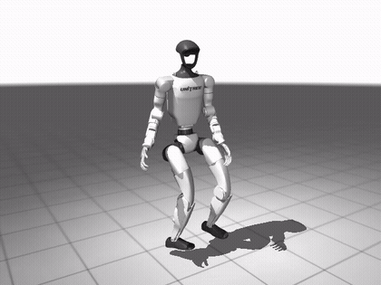
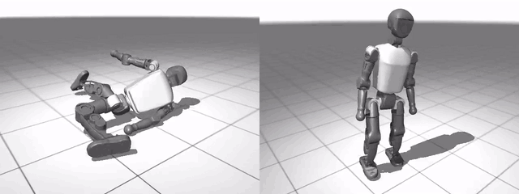
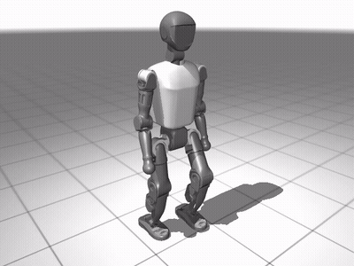
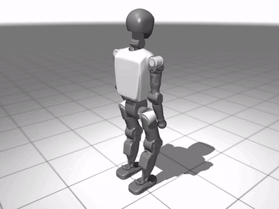

# humanoid-mimic-rl

Humanoid policies trained in MuJoCo (MJX): Booster T1 walk and get-up with Brax PPO, and a SuperMimic-style
world-model reimplementation (backprop through imagined rollouts) that tracks motion clips on the T1 and on the
Unitree G1, including a CMU-mocap spin kick on the G1 at its published peak torques.

| Spin kick (Unitree G1, SuperMimic, CMU mocap 88_06): published peak torques, self-collision on |
|---|
| [](docs/media/g1_spinkick.mp4) |
| [mp4](docs/media/g1_spinkick.mp4) |

| Get-up (v5): from lying on its back (left) and after slipping into the splits (right) |
|---|
| [](docs/media/getup_full.mp4) |
| [mp4](docs/media/getup_full.mp4) |

| SuperMimic tracking a walk clip (Booster T1, 8 s) |
|---|
| [](docs/media/supermimic_walk.mp4) |
| [mp4](docs/media/supermimic_walk.mp4) |

| Trained walk policy, 0.5 m/s forward command |
|---|
| [](docs/media/walk_full.mp4) |
| [mp4](docs/media/walk_full.mp4) |

## Results

Workstation RTX 5080, deterministic policy, 128 episodes each (`eval/metrics.json`; walk 20 s episodes, get-up 8 s):

| task | env steps | train wall time | episode return | success rate | fall rate | task metric |
|---|---|---|---|---|---|---|
| walk (vx 0.5 m/s) | 151.4 M | 71 min (4255 s incl. JIT) | 46.56 ± 0.25 | 1.00 | 0.00 | fwd speed abs err 0.052 m/s (mean speed 0.466) |
| get-up (v5) | 100.3 M | 82 min (4920 s incl. JIT) | 42.57 ± 5.81 | 0.99 (127/128) | 0.00 | median time to stand 1.32 s (mixed starts) |

SuperMimic tracking, deterministic policy (`eval/metrics.json`; completion = reached the end of the clip without
falling or losing tracking):

| clip | robot | env steps | train wall time | episodes | completion | fall rate | joint RMSE | root pos err | root ori err |
|---|---|---|---|---|---|---|---|---|---|
| walk clip, 8 s | T1 | 114.9 M (14k iterations) | 76 min | 128 | 1.00 | 0.00 | 0.063 rad | 0.18 m | 0.083 rad |
| CMU 88_06 spin kick, 4.2 s | G1, published peak torques | 245.9 M (30k iterations) | 6.3 h | 64 | 1.00 | 0.00 | 0.067 rad | 0.32 m | 0.19 rad |

The spin kick clip fails the inverse-dynamics feasibility check: it needs up to 3.4x the G1's peak torque (left hip
pitch 2.3x). It is trained with `--allow-infeasible-clip`, so the policy follows it closely but not exactly; most of
the 0.32 m root error is where the robot ends up on the floor.

Get-up success = standing for the final 1 s of the 8 s episode. The 128 episodes mix starts: dropped from 0.6 m in a
random orientation, snapshots of a pushed fall, and standing still. Floor-only success is not measured separately yet.

| task | env | method | status |
|---|---|---|---|
| `walk` | playground `T1JoystickFlatTerrain` (unchanged) | playground's joystick reward | trained and evaluated |
| `getup` | `T1Getup` (new) | home-relative actions, standing-gated posture reward, fall-snapshot start curriculum | **trained**: v5 stands in 127/128 (v1 sat, v2 curled up, v3/v4 0 rises) |
| `backflip` | `T1Backflip` (new) | hand-shaped keyframe / phase reward | failed on T1 (clip infeasible, torques ~10x limits); moving to Unitree G1 |
| `mimic` | `T1Mimic` (new) | DeepMimic tracking reward + RSI + early termination | failed on T1 (same infeasible clip); moving to Unitree G1 |
| `supermimic` | `T1Mimic`, `G1Mimic` | learned world model + backprop through imagined rollouts | **trained**: T1 walk clip and G1 CMU spin kick, 100 % completion, 0 falls |

The G1 work adds full-body collision with robot self-collision (28 limb/trunk/head/hand pairs), torque motors at the
G1's published peak torques, and a CMU mocap -> G1 retargeting pipeline with a contact-aware torque feasibility check
(`scripts/make_g1_cmu_clip.py`). The CMU clips are not included in this repository; build them from the CMU files.

## Quick start

```bash
pytest tests                              # laptop / CPU, numpy only
scripts/run_ws1.sh smoke                  # GPU: every task, tests, clip, short runs, eval, video
scripts/run_ws1.sh full walk              # one task, full budget
python eval_render.py --run-dir runs/<task>-full-<stamp> --num-episodes 128 --video-episodes 2
```

## More

- [docs/METHOD.md](docs/METHOD.md): the task table, robot, common setup (rates, observations, PPO, full-body
  collisions) and each task's reward: walk, get-up, backflip, DeepMimic, SuperMimic adaptations, the reference clip.
- [docs/USAGE.md](docs/USAGE.md): asset and data licences, environment, single training / eval steps, budgets.
- [docs/RESULTS.md](docs/RESULTS.md): status, the full results table (rows blank until measured) and what was and
  was not verified.

Motion data for the spin kick: "The data used in this project was obtained from mocap.cs.cmu.edu. The database was
created with funding from NSF EIA-0196217."

Known limitations: the T1 backflip reference clip is generated from keyframes (only kinematically plausible), and whether
the T1's actuators can produce a 0.5 s-flight backflip is unknown.
Assets are Apache-2.0 (Booster T1 and Unitree G1 via MuJoCo Playground; G1 meshes MuJoCo Menagerie, BSD-3-Clause); this repository has no licence file yet.
