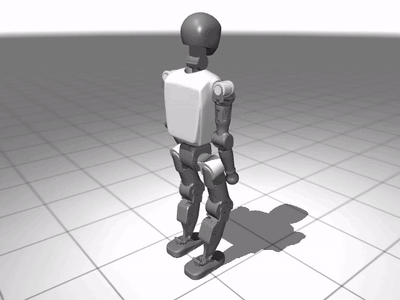

# Status, results and verification (details)

[Back to README](../README.md)

*Trained walk policy, 0.5 m/s forward command ([mp4](media/walk_full.mp4)).*

**Status:** `walk` is trained and evaluated: 128 episodes of 20 s, 0 falls, 100 % success, 0.47 m/s against a 0.5 m/s
command. `getup` (v5) is trained: 127/128 episodes end standing, median time to stand 1.32 s. `supermimic`
is trained on two clips: the T1 walk clip (128/128 complete, 0 falls, joint RMSE 0.063 rad) and the CMU spin kick on
the Unitree G1 at published peak torques with self-collision (64/64 complete, 0 falls, joint RMSE 0.067 rad).
`backflip` and DeepMimic `mimic` did not learn on the T1 (the keyframed clip is physically infeasible). See "Results" and "What was verified".

## Results

Measured on workstation1 (RTX 5080, jax 0.9.2, brax 0.14.2, playground 0.2.0), from `eval/metrics.json` with the
deterministic policy over 128 episodes of 20 s. Rows stay blank until measured.

| task | env steps | train wall time | env steps/s | episode return | success rate | fall rate | task metric |
|---|---|---|---|---|---|---|---|
| walk (vx 0.5 m/s) | 151.4 M | 71 min (4255 s incl. JIT) | ~36.9 k | 46.56 ± 0.25 | 1.00 | 0.00 | fwd speed abs err (m/s): 0.052 (mean speed 0.466) |
| getup (v1 reward) | 100.3 M | 37 min | ~51.8 k | 9.49 ± 0.54 | 0.00 (0/128 stood) | 0.00 | converged to sitting upright on the floor |
| getup (v5), 8 s episodes, mixed starts | 100.3 M | 82 min (4920 s incl. JIT) | ~29.4 k | 42.57 ± 5.81 | 0.99 (127/128) | 0.00 | median time to stand 1.32 s; standing 329 of 400 steps in the last training eval |
| backflip | 151 M | ~85 min | ~28-37 k | 3.25 ± 0.03 | 0.00 | 1.00 | max back rotation 0.23 rad; 0 full rotations |
| mimic (keyframed backflip), PPO | | | | | | | max back rotation (rad): / landing success: |
| mimic (keyframed backflip), SuperMimic | (iterations:) | | (it/s:) | | | | max back rotation (rad): / landing success: |
| SuperMimic, T1 walk clip (8 s, 128 episodes) | 114.9 M (14k of 60k iterations, stopped early) | 76 min | ~25 k | 5.82 ± 0.12 | 1.00 completion | 0.00 | joint RMSE 0.063 rad, root 0.18 m / 0.083 rad |
| SuperMimic, G1 CMU 88_06 spin kick (4.2 s, 64 episodes) | 245.9 M (30k iterations) | 6.3 h (22842 s) | ~10.8 k | 2.45 ± 0.23 | 1.00 completion | 0.00 | joint RMSE 0.067 rad, root 0.32 m / 0.19 rad |

## What was verified (and what was not)

**Run on the GPU (workstation1, RTX 5080):** smoke tests of all 5 tasks, then full training for walk, getup (v1
reward), backflip and mimic.
- **walk** works: 0 falls in 128 × 20 s episodes (table above).
- **getup v1** converged to a local optimum, sitting upright, because separate upright and height rewards paid for a
  straight-backed sit. **v2** (`tall_upright` product, squared height, feet-under-torso shaping) curled up instead,
  because the feet-under term paid for it.
- **getup v3/v4** (real standing starts, fall-snapshot curriculum, gated feet term, lower action-rate penalty): 0 rises.
  Actions were offsets from the *current* joint angles, so zero action gave no restoring force and even standing
  starts collapsed.
- **getup v5 works:** actions are offsets from the home pose (0 = home, ±1 = joint limits) plus a per-step bonus while
  upright. The standing score stayed low until ~45 % of training, then rose 18 → 329 of 400 steps. Evaluation: 127/128
  episodes end standing, 0 falls, median time to stand 1.32 s. Not measured yet: success from floor starts only
  (the 128 episodes mix fallen, falling and standing starts).
- **backflip and mimic did not learn**, and inverse dynamics (`mj_inverse`) on the keyframed T1 reference clip shows
  why:
  - In flight the clip needs a wrench of up to 3.7 kN and 1.9 kN·m on the floating base. That must be about 0, so the
    clip is not ballistic.
  - It needs joint torques far beyond the T1 model's limits: hip pitch 488 vs 45 N·m, ankle 222 vs 20, knee 348 vs 60,
    shoulder 93 vs 18. 9 of the 23 joints are over their limit.
- **The flip is moving to the Unitree G1,** with a physically valid reference: ballistic flight, conserved angular
  momentum, and torques within limits, checked by the same inverse-dynamics test before training.

- **SuperMimic evaluation fix:** the first evaluation started 90 % of episodes at random clip times and counted
  reaching the end of the clip as a failure. Evaluation now starts at t = 0 and reports completion, fall and
  tracking-failure rates separately. Training uses the paper's height/tilt termination (`--termination height_tilt`).
- **G1 spin kick:** CMU subject 88 trial 06, retargeted to the G1 (Froude time scaling, IK, contact locks). The
  inverse-dynamics check fails (torque up to 3.4x peak, left hip pitch 2.3x), so it was trained with
  `--allow-infeasible-clip` as an approximation. Self-collision is on. Over training, the time it followed the clip went
  from 1.6 s (1k iterations) to 3.0 s (10k) to the full 4.18 s.
- **Not working yet:** a backflip -> spin kick -> stand routine built from the CMU backflip clip did not learn (no
  rotation past ~45 deg after 20k iterations; that flip needs about 4x the G1's waist torque). Its code is not in
  this repository yet.

**Fixes made during the runs:**
- jax pinned to 0.9.2, because 0.12 removed `jax.device_put_replicated`, which brax 0.14.2 uses;
- `eval_render.py` loads PPO checkpoints whose saved config has null initialisers (a brax 0.14.2 `load_config` bug).

**Tests:** 123 pass, 12 skipped on workstation1 (`pytest -q tests`); the 14 CMU retargeting tests also pass with the
real CMU files and G1 assets (`CMU_MOCAP_DIR`, `G1_XML_DIR`, `G1_MESH_DIR`).
